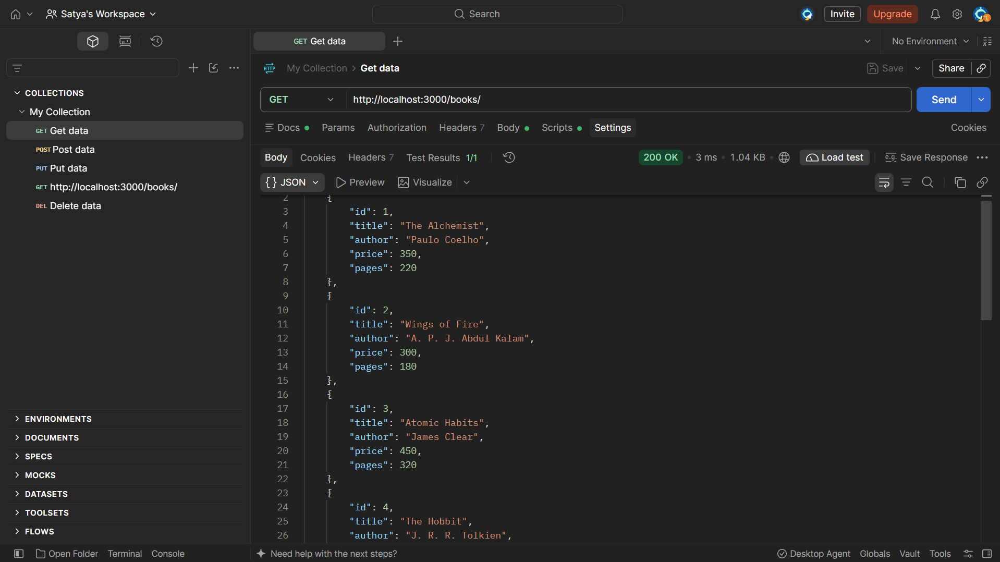
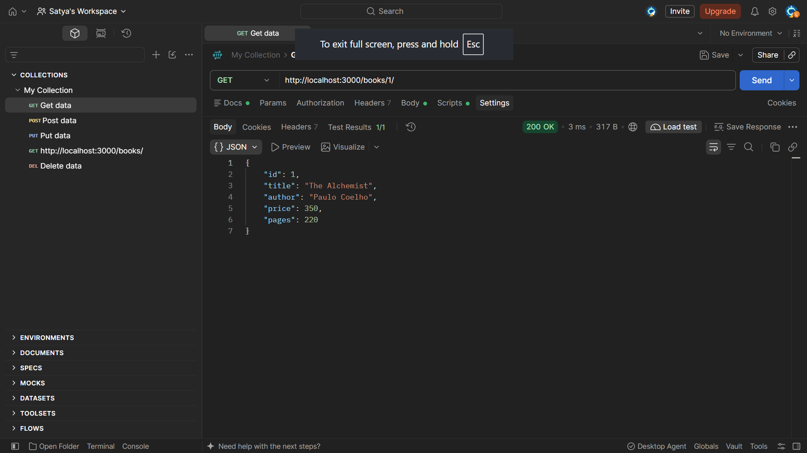
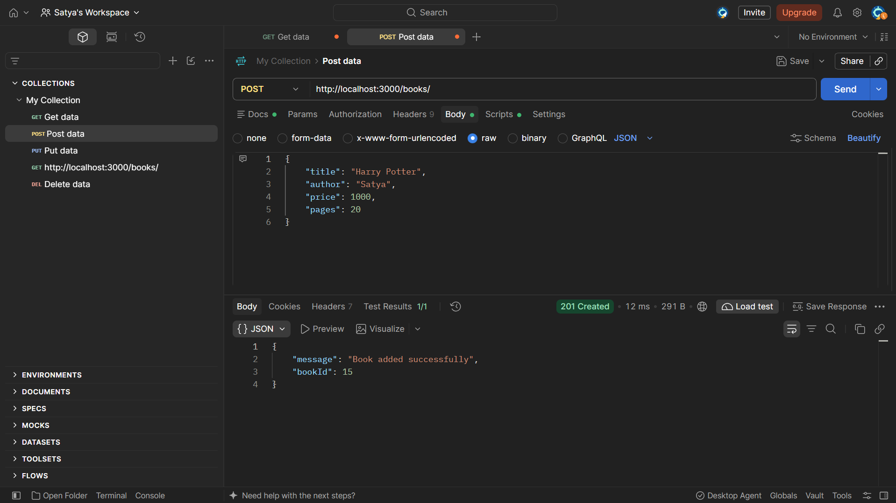
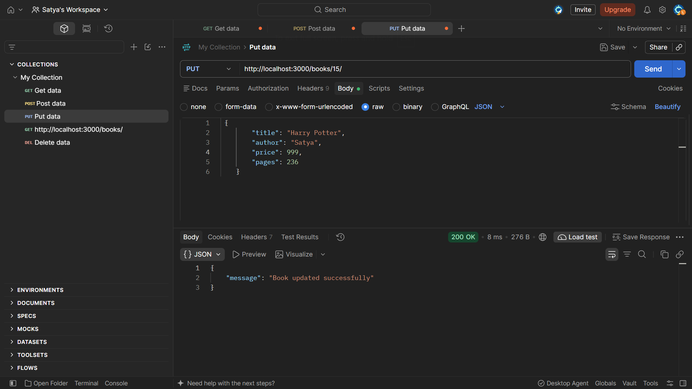
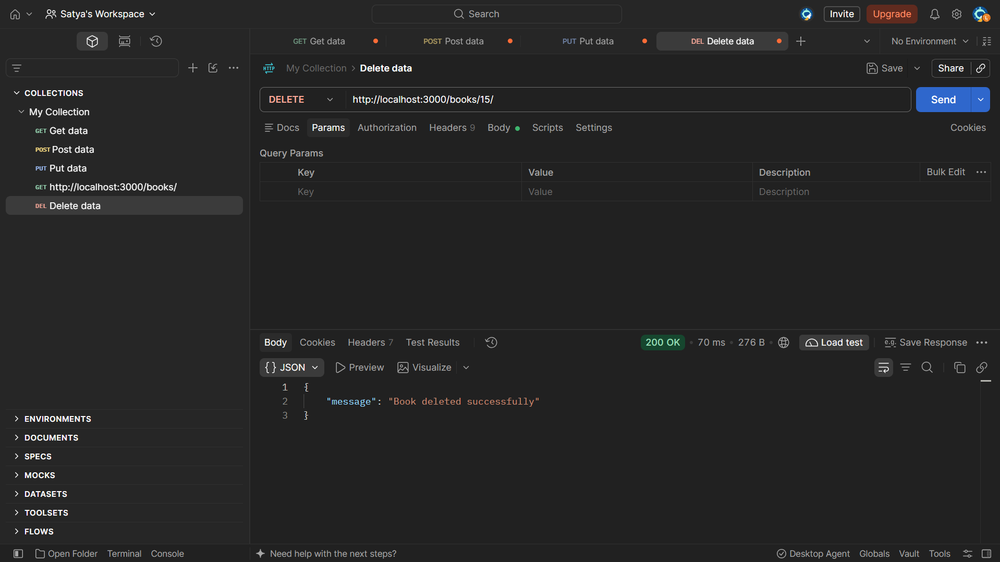

# Lab 2: SQLite Database and CRUD Routes

## Student Details

- **Name:** [B. Satya Rugved]
- **Registration Number:** [252U1R8006]
- **Section:** [CSE(QE)-2A-113]
- **Course:** Backend Development Fundamentals

## Objective

To connect an Express.js server to an SQLite database and implement CRUD operations through HTTP API routes.

## Technologies Used

- Node.js
- Express.js
- SQLite
- sqlite3
- sqlite
- Nodemon
- Postman

## Project Structure

```text
lab-02/
├── app.js
├── package.json
├── package-lock.json
├── books.db
├── .gitignore
├── README.md
└── screenshots/
```

## Installation and Setup

### Prerequisites

Install Node.js and npm. Postman is recommended for testing the API.

### Install dependencies

Open a terminal inside the `lab-02` folder and run:

```bash
npm install
```

### Start the server

For development with automatic restarts:

```bash
npm run dev
```

To start normally:

```bash
npm start
```

The server runs at:

`http://localhost:3000`

### Environment Variables

The default server port is `3000`. The application can optionally use the `PORT` environment variable if configured in `app.js`.

No credentials or secrets are required for the local setup.

## Database Details

The SQLite database file is named `books.db`.

The table is named `book` and contains the following columns:

| Column | Data type | Description |
|---|---|---|
| id | INTEGER PRIMARY KEY AUTOINCREMENT | Unique book ID |
| title | TEXT NOT NULL | Book title |
| author | TEXT NOT NULL | Author's name |
| price | INTEGER NOT NULL | Book price |
| pages | INTEGER NOT NULL | Number of pages |

The application creates the table if it does not exist and inserts 10 sample books when the table is empty.

## API Endpoints

Base URL: `http://localhost:3000`

| Method | Endpoint | Description |
|---|---|---|
| GET | `/books/` | Retrieve all books |
| GET | `/books/:bookId/` | Retrieve a book by ID |
| POST | `/books/` | Add a new book |
| PUT | `/books/:bookId/` | Update an existing book |
| DELETE | `/books/:bookId/` | Delete a book |

### 1. Get all books

**Request:** `GET /books/`

Returns all books as a JSON array.

Expected status: `200 OK`

### 2. Get one book

**Request:** `GET /books/1/`

Returns the book with the specified ID.

Expected status: `200 OK` if found, or `404 Not Found` if the book does not exist.

### 3. Add a book

**Request:** `POST /books/`

Select Body → raw → JSON in Postman.

Example request body:

```json
{
  "title": "Database Fundamentals",
  "author": "John Smith",
  "price": 400,
  "pages": 300
}
```

Expected status: `201 Created`.

### 4. Update a book

**Request:** `PUT /books/1/`

Example request body:

```json
{
  "title": "The Alchemist - Updated",
  "author": "Paulo Coelho",
  "price": 350,
  "pages": 220
}
```

Expected status: `200 OK` if the book is updated.

### 5. Delete a book

**Request:** `DELETE /books/11/`

Replace `11` with the actual ID of the book to delete.

Expected status: `200 OK` if the book is deleted.

## Error Handling

The API handles common errors with appropriate HTTP status codes:

- `400 Bad Request`: Invalid input or book ID.
- `404 Not Found`: Requested book does not exist.
- `500 Internal Server Error`: Unexpected server or database error.

Database queries that receive user input use parameterized SQL with `?` placeholders to help prevent SQL injection.

## Testing with Postman

The following tests were performed during development:

- Retrieve all books.
- Retrieve a book by ID.
- Add a new book.
- Update an existing book.
- Delete a book.
- Check responses for missing book IDs during update and deletion.

Attach screenshots of the actual responses in the `screenshots/` folder before submitting this report.

## Screenshots

### Get all books



### Get one book



### Add a book



### Update a book



### Delete a book




## Deployment

**Live URL:** Pending deployment.

`http://localhost:3000`.

## Problems Faced and Solutions

Database Connection: Connecting the Express server to the SQLite database required proper initialization.
Solution: Used an asynchronous initialization function to establish the database connection before starting the server.

Implementing CRUD Operations: Creating routes for retrieving, adding, updating, and deleting books required correct SQL queries and HTTP methods.
Solution: Implemented the GET, POST, PUT, and DELETE routes and tested them using Postman.

Handling Dynamic Route Parameters: Retrieving or modifying a particular book required extracting its ID from the URL.
Solution: Used the bookId route parameter to identify the required book.

Preventing SQL Injection: Passing user input directly into SQL queries can create security risks.
Solution: Used parameterized SQL queries with ? placeholders to safely pass input values.

Testing API Endpoints: Each endpoint needed to be checked to ensure it returned the expected response.
Solution: Tested all five endpoints in Postman and verified that the operations worked correctly.

## Conclusion

The project implements CRUD operations using Express.js and SQLite. It demonstrates database initialization, parameterized SQL queries, asynchronous database operations, HTTP status codes, and API testing with Postman.
